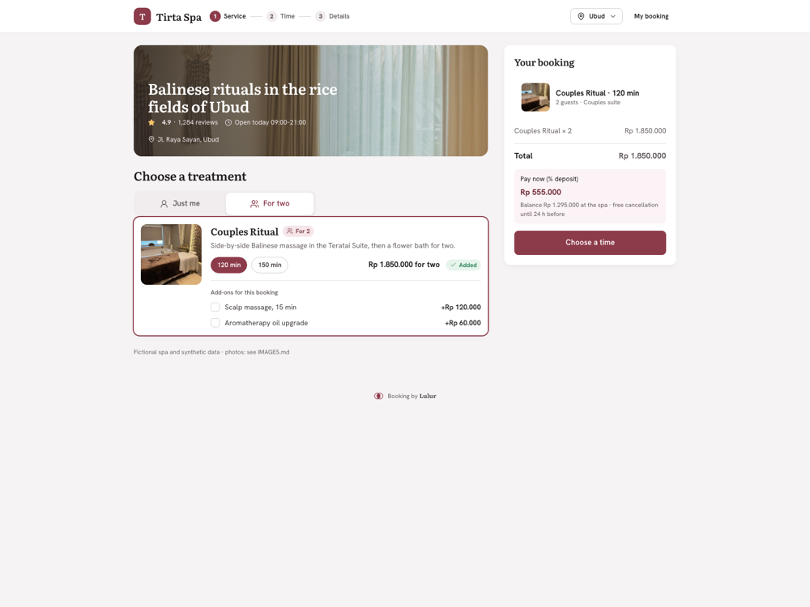
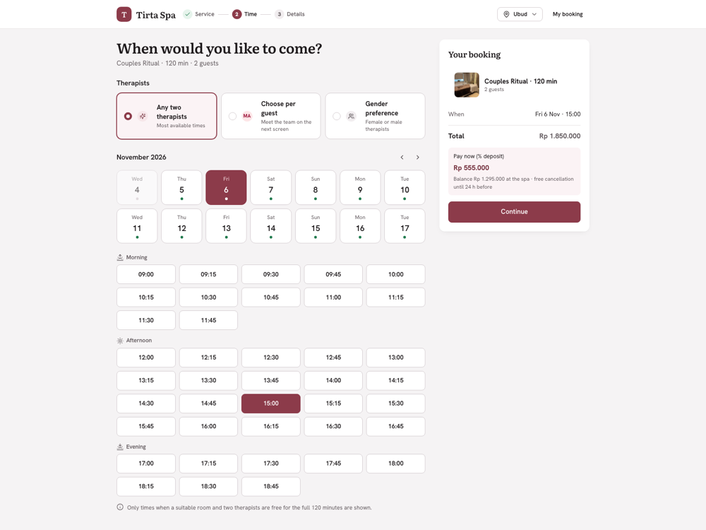
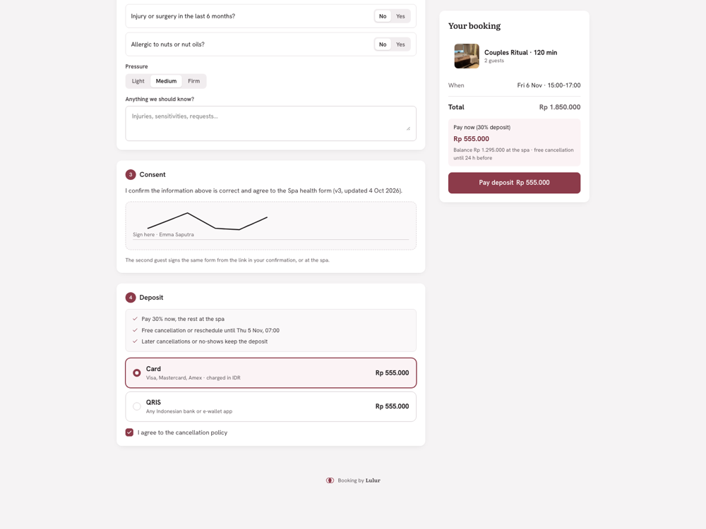
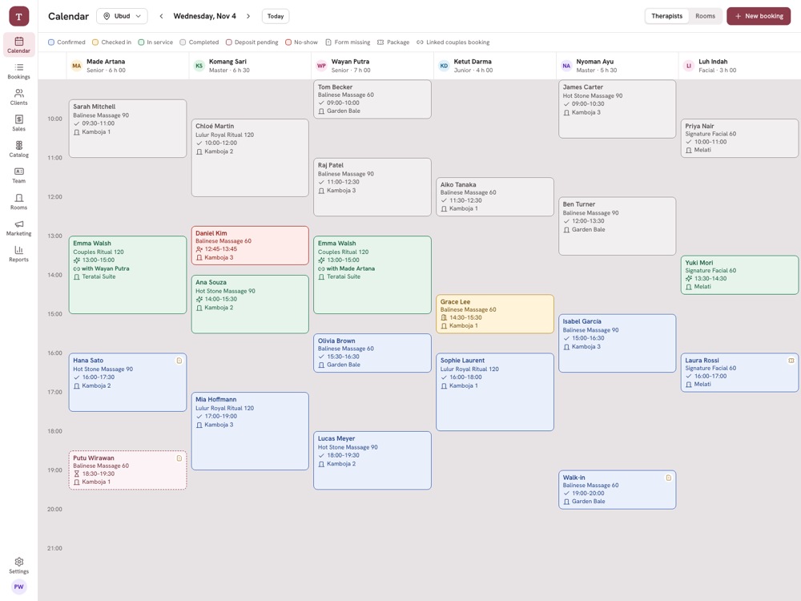
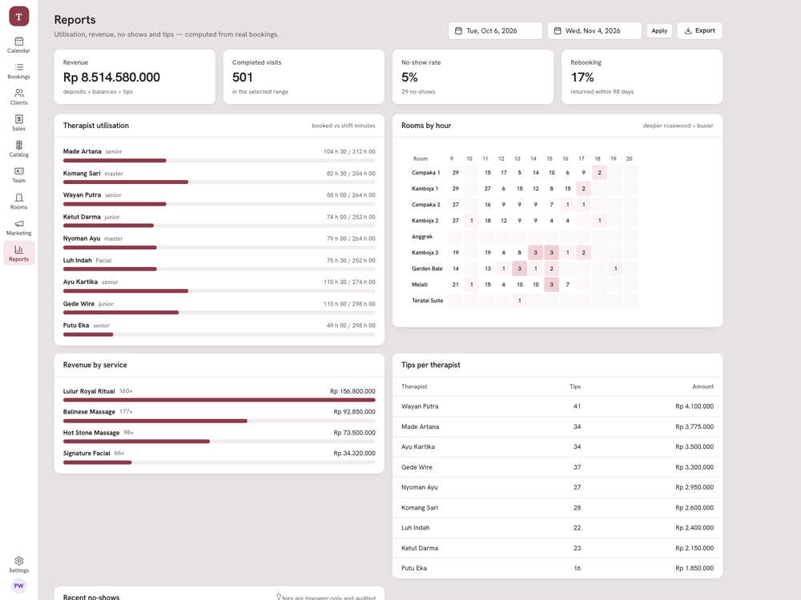
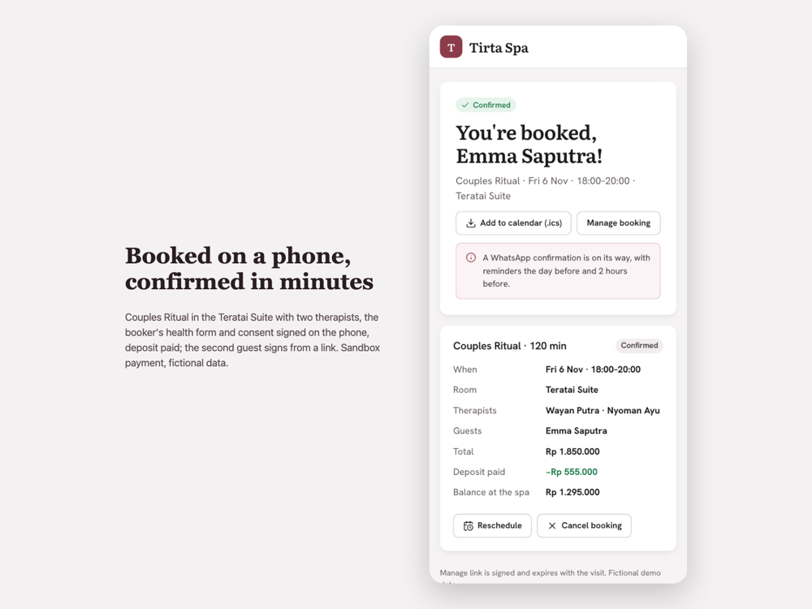

# Lulur — multi-tenant booking for spas and aesthetic clinics


Lulur is a booking platform for wellness businesses (day spas, massage studios, aesthetic clinics). A time slot is only offered when a **qualified therapist AND a suitable room are both free at the same time** — including couples bookings (two therapists plus a couples suite) and the buffer between sessions. Around that core: deposits and no-show fees, versioned intake and consent forms with e-signature, session packages, gift cards, tips, WhatsApp/email reminders and a front-desk calendar.

> Everything here is a demo with fictional data. Payments run against a built-in sandbox gateway and WhatsApp/email are written to the log; nothing is sent to real providers. See [What is and is not real](#what-is-and-is-not-real).

## Screenshots

| Booking (desktop) | Time picker | Consent + deposit |
|---|---|---|
|  |  |  |

| Front-desk calendar | Reports | Booked on a phone |
|---|---|---|
|  |  |  |

## What it does

- **Availability engine** — 15-minute grid over opening hours; candidate therapists need the skill, a shift covering the slot, no time off, and the requested gender if any; rooms must match the type (a couples suite is only used for a single treatment when nothing else is free). A slot is valid when at least N therapists and one room are free for duration + buffer. Auto-assignment picks the least-booked therapist and the tightest-fitting room.
- **No double booking, enforced by the database** — every therapist and every room of a booking is a row in `booking_resources`, and PostgreSQL exclusion constraints (`EXCLUDE USING gist` on `tenant`, resource and time range) make overlapping rows impossible even under a race.
- **10-minute holds** — choosing a slot creates a `held` booking; a scheduled job releases expired holds; a successful deposit confirms it.
- **Deposits and policies** — per-tenant (and per-service) deposit %, saved-card mode, cancellation window and no-show fee; the policy is snapshotted onto the booking so later changes are not retroactive.
- **Payments** behind a `PaymentGateway` interface; webhook handling is idempotent by `idempotency_key` (a replay changes nothing).
- **Forms** — intake/consent forms are versioned (`forms` → `form_versions` → `form_submissions`), signed on the phone, expire after 12 months, and the calendar flags "Form missing".
- **Multi-tenant** — subdomain resolution, a global `tenant_id` scope on every tenant model, plus PostgreSQL row-level security as a second layer.
- **Front desk** — calendar by therapist or by room, drag-to-move with conflict validation, walk-ins, check-in, checkout with tip split, no-show fee (managers only, audited), client profiles, packages and gift cards, utilisation / revenue / no-show / tip reports.
- **Roles** — owner, manager, front desk, therapist (mobile "Today" view), platform admin; TOTP 2FA; activity log.
- **Reminders** — confirmation, 1 day and 2 hours before, with quiet hours; a client replying `STOP` stops WhatsApp reminders (email is unaffected).

## Stack

Laravel 12, PostgreSQL 16+ (`btree_gist`), Redis, Inertia + Vue 3, Vite. Fonts (Hanken Grotesk, Literata) are self-hosted. UI controls are custom (no native select/date/checkbox/radio).

## Run it

```bash
composer install
npm install && npm run build

# PostgreSQL with the btree_gist extension, and Redis
cp .env.example .env     # set DB_* (pgsql) and REDIS_*
php artisan key:generate
php artisan migrate:fresh --seed
php artisan serve --port=8010
```

Open `http://127.0.0.1:8010/` — without a subdomain the request falls back to the default tenant (Tirta Spa). Subdomains work too (`tirta.localhost:8010`, `juniper.localhost:8010`, `rona.localhost:8010`). For hold expiry and reminders, run the scheduler (`php artisan schedule:work`).

The demo data is generated relative to today, so re-run `php artisan migrate:fresh --seed` on a new day to get a populated calendar.

### Demo logins (local environment only, `/demo-login/{email}`)

| Email | Role |
|---|---|
| `owner@tirta.test` | Owner, Tirta Spa (Ubud + Seminyak, IDR) |
| `frontdesk@tirta.test` | Front desk |
| `komang@tirta.test` | Therapist (mobile `/today`) |
| `owner@juniper.test` | Owner, Juniper Massage (Philadelphia, USD, saved card required) |
| `owner@rona.test` | Owner, Rona Aesthetic (Jakarta, 50% deposit) |
| `platform@lulur.test` | Platform admin (phase 2, minimal) |

Password for all seeded users: `password`. Clients book without an account.

## Tests

```bash
php artisan test
```

29 Pest tests (87 assertions) against a real PostgreSQL database, plus 14 Playwright browser tests (7 flows × desktop and phone viewports):

- availability engine (table cases): couples needs suite + two therapists, buffers, gender preference, auto-assignment
- constraints: overlapping room inserts are rejected without the engine; **10 OS processes race for one slot and exactly one booking is created**
- hold expiry and policy snapshot
- tenant isolation across resources
- timezone/DST handling (America/New_York across the November transition)
- time off removes slots; grouped slots always expose all parts of the day
- payment webhook replay confirms once and does not double the deposit
- WhatsApp `STOP` skips WhatsApp reminders but not email
- checkout details create the client, name the guests and store the signed consent

Browser tests (`npm run e2e`, own database `lulur_e2e`, needs PostgreSQL and `npx playwright install chromium`): couples booking from treatment to confirmation with a drawn signature and sandbox deposit, party-size filtering, a held slot disappearing for a second visitor, calendar and detail panel, adding a shift and time off with the custom pickers, therapist landing page, and a scan of every page for native form controls and horizontal scroll.

Not covered: calendar drag-and-drop, and any real payment provider.

## What is and is not real

| Area | State |
|---|---|
| Availability, constraints, holds, multi-tenancy, forms, packages, reports | Implemented and exercised by tests and in the browser |
| Payments | **Sandbox only.** The gateway is a simulated "Lulur Pay" page that triggers the same idempotent code path a provider webhook would. Stripe and Midtrans/Xendit adapters are not written; the webhook endpoints exist but do **not** verify provider signatures yet |
| WhatsApp / email | Written to `storage/logs/laravel.log`; no WhatsApp Cloud API or mail provider is connected |
| Rule versioning | Policies are snapshotted per booking and forms are versioned; there are no effective-dated rule packs |
| Deployment | Not deployed (local only) |

## Project documents

[docs/PRD.md](docs/PRD.md) · [docs/TECH-SPEC.md](docs/TECH-SPEC.md) · [docs/MILESTONES.md](docs/MILESTONES.md) · [docs/IA.md](docs/IA.md) · [docs/SCREENS.md](docs/SCREENS.md) · [docs/FEATURE-MAP.md](docs/FEATURE-MAP.md) · [docs/CASE-STUDY.md](docs/CASE-STUDY.md) · [DESIGN.md](DESIGN.md) · [mockups/](mockups/index.html)

Photos used in the demo are credited in [public/img/credits.json](public/img/credits.json).
